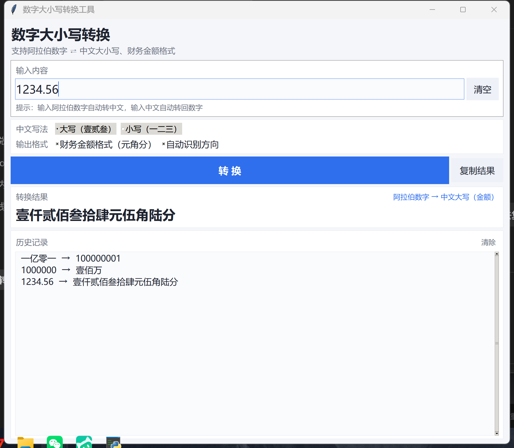

# 数字大小写转换工具

一个基于 Python + Tkinter 的桌面小工具，用于阿拉伯数字与中文大小写之间的双向转换，支持财务金额格式。



## 功能特性

- **双向转换**：输入阿拉伯数字自动转中文，输入中文自动转回数字
- **大写 / 小写**：壹贰叁（财务用）或 一二三
- **财务金额格式**：`1234.56` → 壹仟贰佰叁拾肆元伍角陆分
- **全面支持**：负数、小数（点读法）、万亿级大数
- **界面**：输入即实时预览、一键复制、历史记录（双击可复用）、高分屏 DPI 适配

## 转换示例

| 输入 | 输出 |
| --- | --- |
| `1005` | 一千零五 |
| `10001` | 一万零一 |
| `10010` | 一万零一十 |
| `1234567890` | 十二亿三千四百五十六万七千八百九十 |
| `1234.56`（金额/大写） | 壹仟贰佰叁拾肆元伍角陆分 |
| `100.05`（金额/大写） | 壹佰元零伍分 |
| `0.5`（金额/大写） | 零元伍角 |
| `-520.13`（金额/大写） | 负伍佰贰拾元壹角叁分 |
| `一亿零一`（反向） | 100000001 |

## 运行方式

### 方式一：直接运行 exe（推荐给普通用户）

下载 `dist/数字大小写转换.exe`，双击即可运行，无需安装 Python。

### 方式二：从源码运行

```bash
python main.py
```

> 需要 Python 3.8+ 且包含 tkinter（Windows 官方版 Python 默认自带）。

## 项目结构

```
├── main.py                 # 图形界面入口
├── converter.py            # 核心转换逻辑（可独立复用）
├── test_converter.py       # 测试用例（60 项，全部通过）
├── icon.ico / icon.png     # 程序图标
├── 数字大小写转换.spec      # PyInstaller 打包配置
└── dist/                   # 打包产物
```

## 测试

```bash
python test_converter.py
```

覆盖基础整数、连续零合并、节内补零、小数、负数、金额大写/小写、中文反向解析等边界场景。

## 重新打包 exe

```bash
pip install pyinstaller
python -m PyInstaller --noconfirm 数字大小写转换.spec
```

产物将生成在 `dist/` 目录下。
